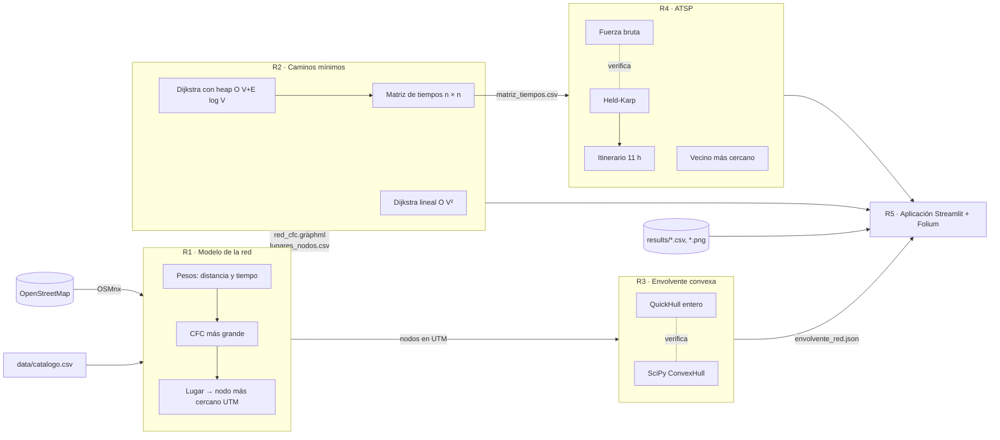

# Arquitectura de la solución

Sección 1 del documento técnico. Muestra los componentes y cómo pasan los datos
de un requerimiento a otro.

## Flujo de datos

| Productor | Archivo | Consumidor |
|---|---|---|
| R1 | `data/processed/red_cfc.graphml` | R2, R3, R5 |
| R1 | `data/processed/lugares_nodos.csv` | R2, R5 |
| R2 | `results/r2/matriz_tiempos.csv` | R4 |
| R3 | `results/r3/envolvente_red.json` | R5 |
| R1–R4 | `results/rX/*.csv` y gráficas | Documento técnico, R5 |

## Decisiones

| Decisión | Motivo | Spec |
|---|---|---|
| Python para todo | OSMnx es de Python y todas las mediciones deben estar en el mismo lenguaje | Enunciado §3 |
| Listas de adyacencia | Red muy dispersa (E ≈ 2–3 V) | R1-B05 |
| Índices 0..V-1 en los algoritmos | Arreglos en lugar de diccionarios; costo O(1) real | R2 |
| `heapq` con eliminación perezosa | Python no tiene `decrease-key`; conserva O((V+E) log V) | R2-B08 |
| QuickHull con enteros y pila explícita | h ≪ n en la red; giros exactos; sin límite de recursión | R3 |
| Held-Karp con tablas aplanadas | Memoria contigua, índice `S·k + j` | R4-B09 |
| Vecino más cercano | Voraz más simple; contraste directo con Dijkstra | R4-B13 |
